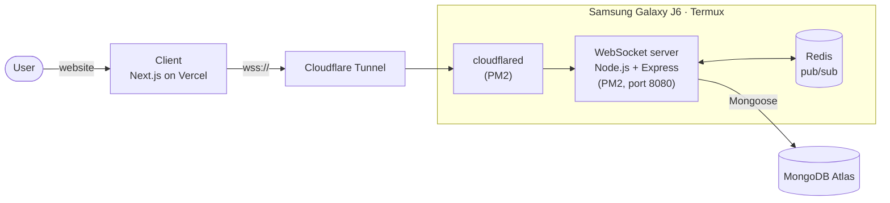
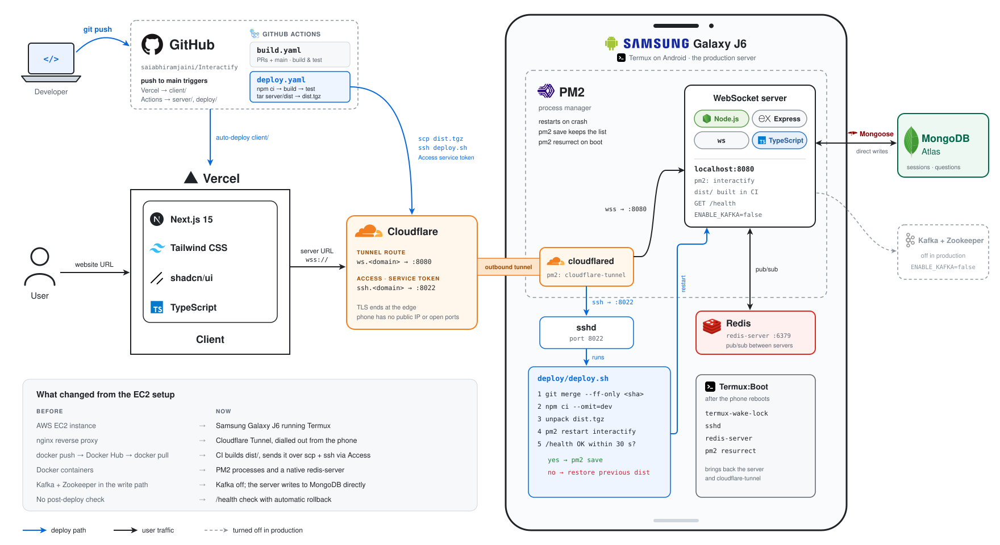
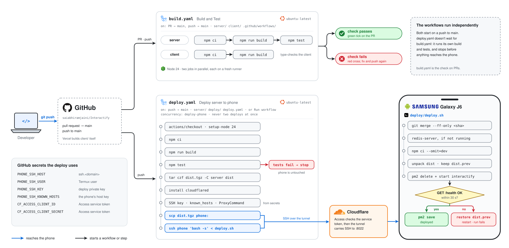
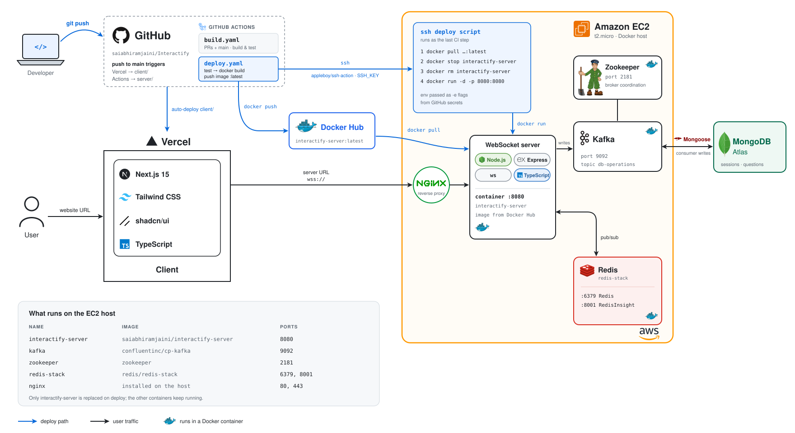
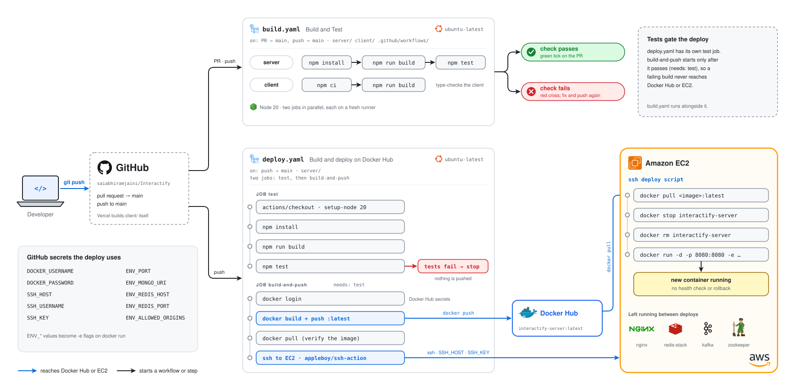

# Interactify - Real-Time Audience Interaction Platform


## Overview

Interactify solves the challenge of managing audience questions during seminars and presentations by providing a real-time interactive platform where:
- Attendees can submit and vote on questions
- Popular questions rise to the top automatically
- Presenters can easily identify and address the most relevant questions
- All interactions happen in real-time via WebSockets


## Features

**For Presenters:**
- Create interactive sessions with unique room codes
- View real-time question ranking
- Mark questions answered or highlighted, and end the session
- Presenter controls are tied to the browser that created the session (a secret owner token kept in `localStorage`)

**For Attendees:**
- Join sessions via room code or shared link
- Submit questions under a generated or chosen display name
- Upvote questions (click again to remove your vote)
- See question rankings update in real-time

## Tech Stack

### Frontend
- **Next.js** (React framework)
- **TailwindCSS** (Utility-first CSS)
- **ShadCN UI** (Beautifully designed components)
- **TypeScript** (Type-safe JavaScript)

### Backend
- **Node.js** (Runtime environment)
- **WebSockets** (Real-time communication)
- **Redis** (Pub/Sub pattern for scalability)
- **Kafka** (Optional write pipeline, enabled with `ENABLE_KAFKA=true`)

### Database
- **MongoDB Atlas** (Cloud database service)
- **Mongoose** (ODM for MongoDB)

### Infrastructure
- **Android phone + Termux** (Server host: a Samsung Galaxy J6)
- **PM2** (Keeps the server and tunnel running)
- **Cloudflare Tunnel + Access** (Public URL for the server, and authenticated SSH for deploys)
- **Vercel** (Client hosting)
- **GitHub Actions** (CI/CD pipelines)
- **Docker** (Local Redis/Kafka, and an optional container image for the server)

## Architecture


1. **Client-Server Communication**: WebSocket connections for real-time updates
2. **Redis Pub/Sub**: Handles message broadcasting across multiple server instances
3. **Kafka (optional)**: When enabled, session writes are produced to the `db-operations` topic (keyed by room so each room's writes stay in order), applied by a consumer, and acknowledged back over Redis before the server replies
4. **MongoDB**: Persistent storage for sessions and questions

The diagrams above show the full design with Kafka. In production Kafka is turned off, and writes go straight from the server to MongoDB:




## Setup & Installation

### Prerequisites
- Node.js (v20+; CI uses v24)
- Docker
- Docker Compose
- MongoDB Atlas account

### Local Development Setup

1. **Clone the repository**:
   ```bash
   git clone https://github.com/saiabhiramjaini/Interactify.git
   cd Interactify
   ```

2. **Set up environment variables**:
   - Create `.env` files in both `client/` and `server/` directories
   - Example `.env` for server:
     ```ini
     PORT=8080
     REDIS_HOST="localhost"
     REDIS_PORT=6379
     MONGO_URI="your_mongodb_atlas_connection_string"

     # Optional
     SERVER_ID="server-1"                     # Shown in /health and logs
     ALLOWED_ORIGINS="http://localhost:3000"  # Comma-separated; unset = accept WebSockets from any origin
     ENABLE_KAFKA=false                       # true routes writes through Kafka
     KAFKA_BROKERS="localhost:9092"           # Defaults to $PRIVATE_IP:9092, then localhost:9092
     ```
   - Example `.env` for client:
     ```ini
     NEXT_PUBLIC_WS_URL=ws://localhost:8080
     ```

3. **Start infrastructure services** (using Docker Compose recommended):
   ```bash
   cd server
   docker compose up -d                    # Redis only
   docker compose --profile kafka up -d    # Redis, Zookeeper and Kafka (for ENABLE_KAFKA=true)
   ```

4. **Install dependencies and start servers**:
   ```bash
   # In one terminal (server)
   cd server
   npm install
   npm start

   # In another terminal (client)
   cd client
   npm install
   npm run dev
   ```

### Alternative: Individual Docker Containers
If not using Docker Compose, you can start services individually:
```bash
# Redis
docker run -d --name redis-stack -p 6379:6379 -p 8001:8001 redis/redis-stack:latest

# Zookeeper
docker run -d --name zookeeper -p 2181:2181 zookeeper

# Kafka (replace IP with your private IP from ifconfig)
docker run -d --name kafka -p 9092:9092 \
  -e KAFKA_HEAP_OPTS="-Xmx512m -Xms512m" \
  -e KAFKA_ZOOKEEPER_CONNECT=your_private_ip:2181 \
  -e KAFKA_ADVERTISED_LISTENERS=PLAINTEXT://your_private_ip:9092 \
  -e KAFKA_OFFSETS_TOPIC_REPLICATION_FACTOR=1 \
  confluentinc/cp-kafka
```
**NOTE: If you are running individual docker containers then you need to set PRIVATE_IP (or KAFKA_BROKERS) in .env to your system's IP, which you can get by running ifconfig for mac (IP under en0) or ipconfig for windows**

### Running Tests
```bash
cd server
npm test
```
The tests run against an in-memory MongoDB (downloaded on first run), so no external services are needed.

## Deployment

Interactify has been deployed two ways. In both, the client is hosted on Vercel and the data lives in MongoDB Atlas; only the server's host changed.

| | [Android phone](#android-phone-current) (current) | [AWS EC2](#aws-ec2-original) (original) |
| --- | --- | --- |
| Server host | Samsung Galaxy J6 in Termux | EC2 t2.micro |
| Reaching the server | Cloudflare Tunnel, opened from the phone | nginx reverse proxy |
| Shipping a build | CI builds `dist/`, copies it over SSH through Cloudflare Access | CI pushes an image to Docker Hub, EC2 pulls it |
| Processes | PM2 (server, cloudflared) and a native redis-server | Docker containers |
| Writes to MongoDB | Direct (`ENABLE_KAFKA=false`) | Through Kafka |
| After a deploy | `/health` check, automatic rollback | None |

### Android Phone (current)



The server runs on an old Samsung Galaxy J6 in Termux. PM2 keeps it running, and a Cloudflare Tunnel exposes it to the internet, so the phone needs no public IP or open ports. The client is hosted on Vercel.

#### CI/CD pipeline



GitHub Actions runs two workflows:

1. **Build and Test** (`build.yaml`)
   - Runs on pull requests to `main` and on pushes to `main`
   - Builds and tests the server
   - Builds (and type-checks) the client

2. **Deploy server to phone** (`deploy.yaml`)
   - Runs on pushes to `main` that touch `server/` or `deploy/`, or manually from the Actions tab
   - Builds and tests the server again; nothing reaches the phone unless the tests pass
   - Packages the compiled `dist/` and copies it to the phone over SSH, through the Cloudflare tunnel (authenticated by a Cloudflare Access service token)
   - Runs [`deploy/deploy.sh`](deploy/deploy.sh) on the phone, which:
     - fast-forwards the repo on the phone to the deployed commit
     - installs production dependencies only
     - swaps in the new build and restarts the server with PM2
     - waits for `/health`, and restores the previous build if it doesn't become healthy within 30 seconds

The two workflows don't wait for each other: `deploy.yaml` runs its own build and tests.

The phone never builds anything: its 32-bit Android userspace can't install the build and test tooling, and building in CI means the phone runs exactly what passed the tests.

See [`deploy/README.md`](deploy/README.md) for the one-time setup: phone packages, the Cloudflare tunnel and Access policy, the deploy key, GitHub secrets, and starting everything on boot with Termux:Boot.

### AWS EC2 (original)



Before the phone, the server ran on an EC2 t2.micro as a set of Docker containers:

- `deploy.yaml` tested the server, built the `server/Dockerfile` image, and pushed it to Docker Hub as `saiabhiramjaini/interactify-server:latest`
- It then connected to the instance over SSH (`appleboy/ssh-action`) and ran `docker pull`, `docker stop`, `docker rm` and `docker run`, passing the server's environment from GitHub secrets
- nginx on the instance proxied WebSocket traffic to the server container on port 8080
- Redis (`redis/redis-stack`, with RedisInsight on port 8001), Kafka and Zookeeper ran as long-lived containers beside it; only the server container was replaced on each deploy

#### CI/CD pipeline



`deploy.yaml` had two jobs. `test` built and tested the server, and `build-and-push` ran only after it passed (`needs: test`), so a failing build never reached Docker Hub or EC2. `build.yaml` checked pull requests and pushes the same way it does today. Once the new container started there was no health check, so a broken image stayed live until the next deploy.

That workflow was replaced by the phone deploy. The last EC2 version is in the git history: `git show 651cf30:.github/workflows/deploy.yaml`.

### Kafka Is Optional

There is a single server in `server/`. Kafka is off by default (`ENABLE_KAFKA=false`), which is how it runs on the phone:

- Writes go straight to MongoDB, and kafkajs is never loaded, keeping memory use low
- WebSocket communication and Redis pub/sub work exactly as with Kafka enabled
- Set `ENABLE_KAFKA=true` (and run Zookeeper and Kafka) to route writes through Kafka instead

### Other Hosts

The server's `Dockerfile` still builds a production image for any container host. It listens on port 8000 inside the container unless you pass `-e PORT=...`.


## Scaling Test

To verify the system's scalability:
```bash
# Terminal 1 - Server 1
PORT=8080 SERVER_ID=server-1 npm start

# Terminal 2 - Server 2
PORT=8081 SERVER_ID=server-2 npm start

# Terminal 3 - Client 1
NEXT_PUBLIC_WS_URL=ws://localhost:8080 npm run dev

# Terminal 4 - Client 2
NEXT_PUBLIC_WS_URL=ws://localhost:8081 PORT=3001 npm run dev
```


This setup demonstrates:
- Multiple server instances handling different client connections
- Redis Pub/Sub ensuring synchronized state across servers
- (With `ENABLE_KAFKA=true`) Kafka carrying writes from both servers

## Contributing

We welcome contributions! Please follow these steps:
1. Fork the repository
2. Create a feature branch (`git checkout -b feature/your-feature`)
3. Commit your changes (`git commit -am 'Add some feature'`)
4. Push to the branch (`git push origin feature/your-feature`)
5. Open a Pull Request


**GitHub Repository**: [https://github.com/saiabhiramjaini/Interactify](https://github.com/saiabhiramjaini/Interactify)
